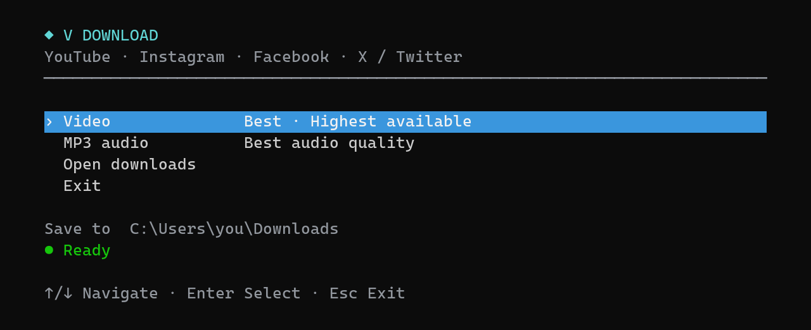
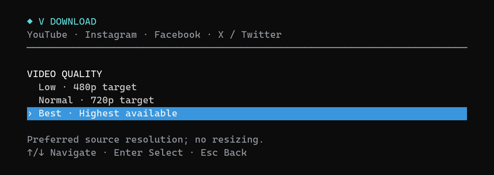
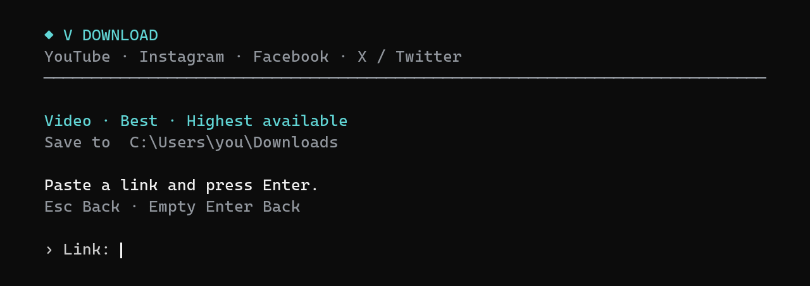

# ◆ V DOWNLOAD

**Download videos and MP3 audio from your terminal.**

YouTube · Instagram · Facebook · X / Twitter

Choose with the arrow keys, paste a link, and press Enter.

[**Download ZIP**](https://github.com/Shohruh04/vdownload/archive/refs/heads/main.zip) · [Quick start](#quick-start) · [Terminal previews](#terminal-previews) · [Controls](#keyboard-controls)

## Features

| Feature | What you get |
| --- | --- |
| Four platforms | Video links from YouTube, Instagram, Facebook, and X / Twitter |
| Video quality | Low, Normal, or Best, with Best selected by default |
| MP3 audio | Best available source audio and the highest MP3 VBR encoding quality |
| Simple controls | Arrow-key selection, Enter to confirm, and Esc to go back |
| Download progress | Percentage, speed, and estimated time remaining |
| Readable filenames | Instagram captions or video titles, without video IDs |
| Safe duplicate names | A suffix such as <code>(2)</code> keeps existing files intact |
| Your Downloads folder | Supports redirected folders and opens them from the menu |

Powered by [yt-dlp](https://github.com/yt-dlp/yt-dlp) and [FFmpeg](https://ffmpeg.org/).

## Quick start

### 1. Prepare the dependencies

V DOWNLOAD runs on **Windows 10 or 11** with **Windows PowerShell 5.1 or later**. Install these components first:

| Dependency | Purpose |
| --- | --- |
| [Python](https://www.python.org/downloads/windows/) + [yt-dlp](https://github.com/yt-dlp/yt-dlp) | Retrieve and download media |
| [FFmpeg and ffprobe](https://ffmpeg.org/download.html) | Merge video and audio, and convert audio to MP3 |
| [Node.js](https://nodejs.org/) | JavaScript support used by yt-dlp |

Install or update yt-dlp with the Python installation you want to use:

~~~powershell
python -m pip install --upgrade "yt-dlp[default]"
~~~

Make the executable files available in **PATH**, and keep FFmpeg and ffprobe in the same directory. The app also checks your user-local bin directory and standard per-user Python installation directories.

**The ZIP contains V DOWNLOAD, not the dependencies.** The installer creates the command and desktop launcher; it does not install Python, yt-dlp, FFmpeg, or Node.js.

### 2. Get the app

[**Download the ZIP**](https://github.com/Shohruh04/vdownload/archive/refs/heads/main.zip) and extract it, or clone the repository:

~~~powershell
git clone https://github.com/Shohruh04/vdownload.git
cd vdownload
~~~

### 3. Launch

Double-click **vdownload.cmd** inside the extracted folder.

For a desktop launcher and the <code>vdownload</code> command, double-click **install.cmd** instead. No administrator permissions are needed. Reopen your terminal, then run:

~~~cmd
vdownload
~~~

### 4. Download

1. Select **Video** or **MP3 audio** with **↑ / ↓**, then press **Enter**.
2. For video, select **Low**, **Normal**, or **Best**.
3. Paste the video link and press **Enter**.
4. Find the completed file in **Downloads**.

Press **Esc** from quality selection or link entry to return to the main menu.

## Terminal previews

*Rendered from the current app's terminal output. The save path shown is an example.*

### Choose video quality

Best is selected by default. Use the arrow keys to change it.

| Preset | Resolution preference |
| --- | --- |
| **Low** | 480p target |
| **Normal** | 720p target |
| **Best — default** | Highest available source quality |

These are source-quality preferences. The app prefers the highest available resolution at or below the target. If none is available, it selects the lowest resolution above it, **without resizing**. For example, a reel with no 480p source may download at 720p in Low mode.

### Paste your link

Paste a link, press Enter, and watch the progress. Esc cancels link entry, including any text already entered.

MP3 mode skips video-quality selection and uses the best available audio. The MP3 encoder uses its highest VBR quality setting; it cannot improve the original recording.

## Keyboard controls

| Key | Action |
| --- | --- |
| **↑ / ↓** | Move between menu options |
| **Enter** | Confirm a selection or start downloading the entered link |
| **Esc** | Back from quality selection or link entry; exit from the main menu |
| **Empty link + Enter** | Return without downloading |
| **Ctrl+V / Shift+Insert** | Paste into the link field |
| **Enter / Esc after a download** | Return to the menu |

Your selected format and video quality stay selected when you return during the same session.

## Files and installation

Completed files go to your Windows **Downloads** folder. Filenames use the first caption line for Instagram and the video title on other platforms:

~~~text
Farqi nimada.mp4
Farqi nimada - Normal.mp4
Farqi nimada.mp3
Farqi nimada (2).mp4
~~~

Low and Normal video variants have separate suffixes. Duplicate names receive a number, so existing files are not overwritten. Videos keep the available source container; MP3 mode produces <code>.mp3</code>.

The installer uses:

| Location | Contents |
| --- | --- |
| <code>%USERPROFILE%\.local\share\vdownload</code> | Installed app and README |
| <code>%USERPROFILE%\.local\bin</code> | <code>vdownload.cmd</code> command launcher |
| Desktop | <code>VDownload.cmd</code> launcher |

The app runs locally. It downloads one submitted link at a time and disables YouTube playlist expansion.

## Troubleshooting

<strong>Missing dependency</strong>

Install the named component, add its executable directory to PATH, and reopen your terminal. Keep FFmpeg and ffprobe together.

<strong>The vdownload command is not recognized</strong>

Run **install.cmd**, then reopen your terminal. You can also use the desktop launcher or run the installed launcher directly:

~~~cmd
"%USERPROFILE%\.local\bin\vdownload.cmd"
~~~

<strong>A link does not download</strong>

Read the error shown in the terminal. Availability depends on the specific URL and the current yt-dlp extractors. Private, deleted, region-restricted, or login-required media may fail.

This version does not import browser cookies or account sessions, and it ignores existing yt-dlp configuration files.

If a platform has changed, update yt-dlp:

~~~powershell
python -m pip install --upgrade "yt-dlp[default]"
~~~

<strong>The arrow-key menu does not work with piped input</strong>

Open the app in an interactive terminal window. The menu reads keyboard events directly.

<strong>Check the installation or print a preview</strong>

~~~cmd
vdownload -Check
vdownload -Preview
~~~

<code>-Check</code> verifies dependency discovery. <code>-Preview</code> prints the main menu without reading keys or downloading media.

## Verification

An Instagram reel was tested in all three video presets and MP3 mode. All four output files passed a full FFmpeg decode. Keyboard navigation, Esc cancellation, long-link editing, and duplicate filename protection were also checked.

Support for a platform does not guarantee that every URL on that platform can be downloaded.
